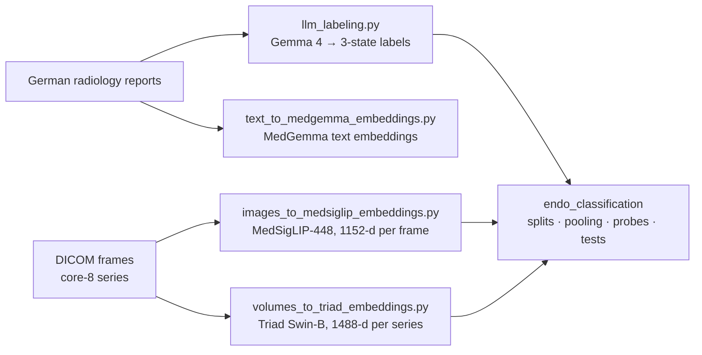

# endo-detect

This repository contains the code for my master's thesis **"Multimodal Deep Learning for Endometriosis Detection from Pelvic MRI and Radiology Reports"** at the Institute of Machine Learning, Johannes Kepler University (JKU) Linz, under the supervision of Dr. Philipp Seidl.

In the thesis, we classify three endometriosis-related conditions from multi-series pelvic magnetic resonance imaging (MRI):

| Key | Condition |
|---|---|
| `die` | Deep infiltrating endometriosis |
| `endometrioma` | Ovarian endometrioma |
| `adenomyosis` | Adenomyosis |

The methods, experiments and results are described in the [thesis manuscript](#ToDo). This README only explains how the code is organized and how to run it.

> **Data are not included.** The MRI studies and radiology reports are clinical data shared under a data-sharing agreement, so we cannot publish them. The code expects pseudonymized DICOM files, a frame manifest and cleaned report text (see [Expected inputs](#expected-inputs)).

---

## Pipeline



The pipeline has four steps. First, a large language model (LLM) extracts one label per condition from each report. Second, frozen foundation models embed the MRI frames or series. Third, the embeddings are pooled into one vector per MRI accession. Finally, a classifier is trained and evaluated on these vectors with patient-grouped splits and permutation tests. The design choices behind each step are explained in the manuscript.

---

## Repository layout

```
endo-detect/
├── endo_classification/            # classification and evaluation package
│   ├── train_test_split.py         # accession table, patient-grouped split search
│   ├── representations.py          # pooling strategies (fit/transform interface)
│   ├── attention.py                # two-level attention pooling (AttentionPool)
│   ├── classifiers.py              # LogReg and MLP probes
│   ├── evaluate.py                 # held-out evaluation, inner CV, permutation and paired tests
│   ├── plots.py                    # figures from the evaluate.py result tables
│   └── _torch_utils.py             # deterministic-execution helpers
├── images_to_medsiglip_embeddings.py   # frames  → MedSigLIP embeddings (.npy + keys)
├── volumes_to_triad_embeddings.py      # series  → Triad Swin-B embeddings
├── text_to_medgemma_embeddings.py      # reports → MedGemma text embeddings
├── llm_labeling.py                     # reports → condition labels (Gemma 4)
├── prompts/gemma4_labeling.py          # labeling prompts (strategies A and B)
├── utils/
│   ├── utils.py                        # GPU selection, run statistics, file loading
│   └── visualize_frames_df.py          # frame viewer and per-series GIF export
└── environment/endo_env.yml            # conda environment
```

---

## Installation

```bash
git clone https://github.com/exVick/endo-detect.git
cd endo-detect
conda env create -f environment/endo_env.yml
conda activate endo_env
```

The environment pins Python 3.11, PyTorch 2.7.1 (CUDA 11.8 build), transformers 5.14.1, scikit-learn 1.8.0, pandas 3.0.0 and pydicom 3.0.1. In addition, it includes `pylibjpeg` to decode compressed DICOM files. We kept the CUDA 11.8 build because newer builds no longer support Volta (sm_70) GPUs.

MedSigLIP, MedGemma and Gemma 4 are gated models on Hugging Face. Therefore, you have to accept their terms and log in with `huggingface-cli login` before running the scripts. The Triad checkpoint (`Triad-SwinB-SimMIM.pth`) has to be downloaded separately from the Triad release.

---

## Expected inputs

| Input | Used by | Required columns |
|---|---|---|
| Frame manifest (CSV or Parquet, one row per 2D frame) | `images_to_medsiglip_embeddings.py` | `FilePath`, `SOPInstanceUID`, `frame_index`, `SeriesInstanceUID`, `AccessionNumber` |
| Frame manifest (Parquet) | `volumes_to_triad_embeddings.py` | as above, plus series description and slice order |
| Cleaned reports (Parquet) | `llm_labeling.py` | `clean_report` |
| Report text (CSV or Parquet) | `text_to_medgemma_embeddings.py` | `pdf_text` |

The DICOM parsing, report cleaning, merging and deduplication happen before these scripts and are not part of this repository.

---

## Usage

All GPU scripts take a physical GPU ID. The scripts set it as `CUDA_VISIBLE_DEVICES` before CUDA is initialized.

**Label extraction**

```bash
python llm_labeling.py \
    --input_file reports_clean.parquet \
    --output_file labels.parquet \
    --gpu 0 \
    --label_strategy A          # A: one JSON per report; B: one generation per entity
```

Each report is labeled per condition as `positive`, `negative` or `not_stated`. Later, `not_stated` is treated as missing and masked out, not as negative.

**Frame embeddings (MedSigLIP)**

```bash
python images_to_medsiglip_embeddings.py \
    --input_file manifest_frames.parquet \
    --output_file embeddings/embeddings.npy \
    --gpu 0 --batch_size 64
```

The script writes `embeddings.npy` (n_frames × 1152, float32) and `embeddings_keys.parquet`. The keys file maps each row back to the manifest through `input_row`. Note that cuDNN is disabled in this script, because the SigLIP patch-embedding convolution has no cuDNN engine on Volta GPUs.

**Series embeddings (Triad Swin-B)**

```bash
python volumes_to_triad_embeddings.py \
    --frames manifest_frames.parquet \
    --ckpt Triad-SwinB-SimMIM.pth \
    --out_dir triad_embeddings \
    --device cuda:0 [--limit 2]
```

The script embeds each core-8 series as a 96³ volume in two geometries, A and B. It writes `triad_swinb_A.npy`, `triad_swinb_B.npy`, a keys table, `run_config.json` and quality-control figures. Moreover, it appends one line per run to `decisions.jsonl`.

**Report embeddings (MedGemma)**

```bash
python text_to_medgemma_embeddings.py \
    --input_file reports.parquet \
    --output_file text_embeddings.parquet \
    --gpu 0 [--use_8bit]
```

---

## The `endo_classification` package

Every pooling strategy implements the same `fit` and `transform` interface. As a result, all evaluation functions work on any representation without changes. Pooling strategies that learn from labels are refitted inside every split, on the training accessions only.

```python
import numpy as np, pandas as pd
import endo_classification as ec

frames = pd.read_parquet("manifest_frames.parquet")    # one row per frame, with input_row
E = np.load("embeddings/embeddings.npy")

acc_tbl = ec.build_accession_table(labelled_df)        # one row per accession
labels  = ec.make_labels(acc_tbl)
splits  = [ec.make_split(acc_tbl, seed=s, test_frac=0.25, min_per_class=5)
           for s in range(25)]

rep  = ec.MeanPool(frames, E)
grid = ec.run_grid(rep, labels, splits)                # held-out metrics per split
ec.summarise(grid)
perm = ec.permutation_test(rep, labels, splits, n_perm=1000)
```

| Module | Main objects |
|---|---|
| `representations.py` | `MeanPool`, `SeriesPool`, `per_series`, `SeriesBalancedPool`, `TopKPool` with `ProbeRanker`, `CentroidRanker` and `CentralityRanker` |
| `attention.py` | `AttentionPool`, `SERIES_MAP` |
| `classifiers.py` | `LogReg` (default), `MLP`, selected with `classifier="logreg"` or `classifier="mlp"` |
| `train_test_split.py` | `build_accession_table`, `make_split`, `describe_split` |
| `evaluate.py` | `run_grid`, `run_many`, `run_inner`, `permutation_test`, `paired_test`, `summarise` |
| `plots.py` | plotting functions for the result tables of `evaluate.py` |

The reported metrics are the area under the receiver operating characteristic curve (`auroc`) and average precision (`auprc`, computed with scikit-learn `average_precision_score`). The modules contain detailed docstrings for every function.

**Reproducibility.** All fits are seeded, and permutation seeds are derived with `zlib.crc32`. However, deterministic CUDA execution also requires `CUBLAS_WORKSPACE_CONFIG` to be set before `torch` is imported:

```python
import os
os.environ["CUBLAS_WORKSPACE_CONFIG"] = ":4096:8"
import torch
```

---

## License

The code is released under the [MIT License](LICENSE). The model weights (MedSigLIP, MedGemma, Gemma and Triad) are subject to their own licenses.
